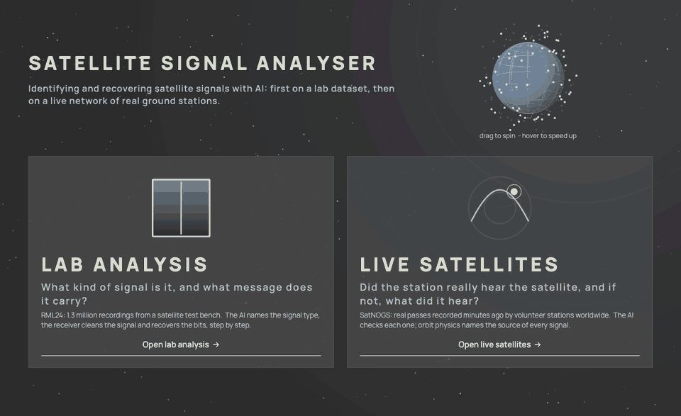
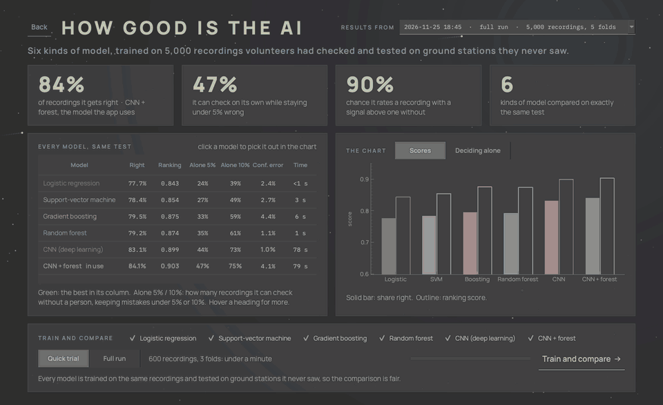
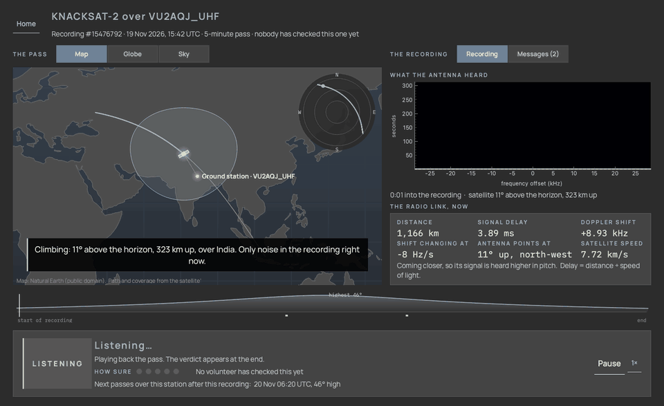
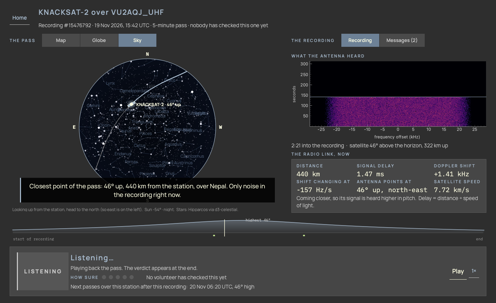
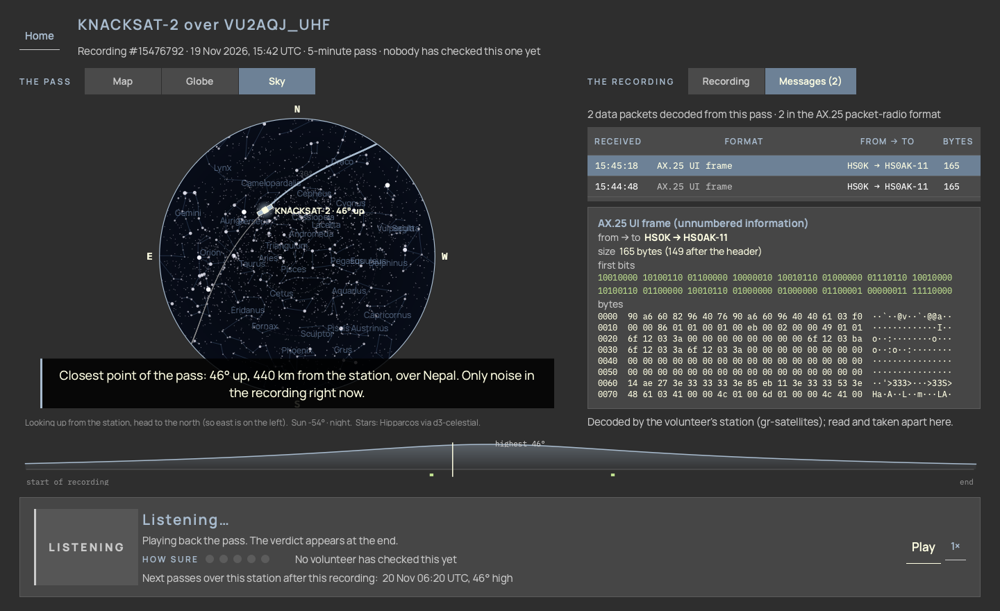
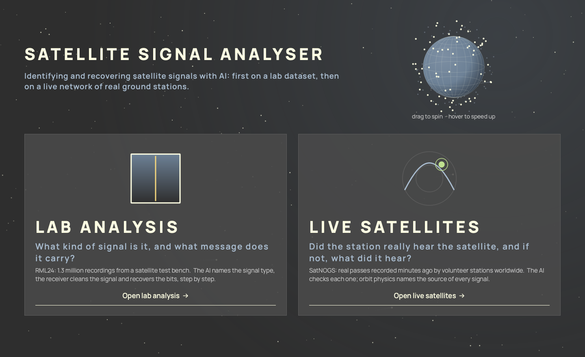
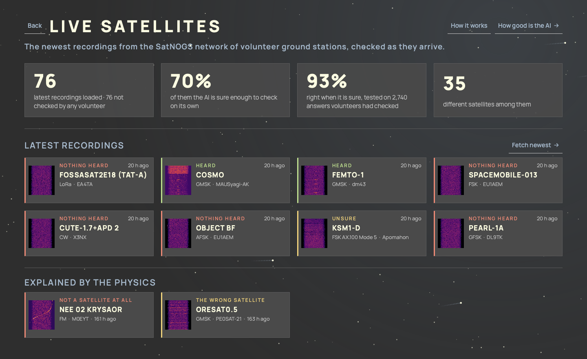

# Satellite Signal Analyser

Automated vetting of real satellite passes from the [SatNOGS](https://network.satnogs.org) global ground-station
network, with calibrated abstention, orbit-physics explanations and a desktop application built on PySide6.
A second module classifies and demodulates impaired signals from the RML24 TT&C dataset.



| | |
|---|---|
| Training data | 5,000 volunteer-labelled SatNOGS observations, 329 ground stations, balanced 50/50 |
| Evaluation | 5-fold `GroupKFold` with **whole ground stations held out** |
| Production model | 2-D ResNet on the waterfall + random forest on 12 engineered features, probabilities averaged, temperature-scaled |
| Accuracy / AUROC | **84.1%** / **0.903** on unseen stations |
| Selective prediction | Decides **46.7%** of observations alone at a 5% error budget, **75.0%** at 10% |
| Codebase | ~35k lines of Python, 926 tests |

---

## Contents

- [The problem](#the-problem)
- [Pipeline](#pipeline)
- [Model comparison](#model-comparison)
- [Why stations are held out](#why-stations-are-held-out)
- [Abstention and calibration](#abstention-and-calibration)
- [Orbit physics: explaining the bright track](#orbit-physics-explaining-the-bright-track)
- [Decoded packets](#decoded-packets)
- [Desktop application](#desktop-application)
- [Architecture](#architecture)
- [Lab module: RML24 signal recovery](#lab-module-rml24-signal-recovery)
- [Setup](#setup)
- [Reproducing the results](#reproducing-the-results)
- [Tests](#tests)
- [Limitations](#limitations)
- [Credits and data](#credits-and-data)

---

## The problem

SatNOGS schedules thousands of satellite passes a day on volunteer stations. Each pass produces a
**waterfall** (a time-frequency spectrogram, Doppler-corrected for the scheduled satellite) that a
human currently marks as *with signal* or *without signal*. On a sample of recent observations,
22 of 25 had no human verdict at all. The backlog is the motivation.

The task is binary classification on a noisy spectrogram, but three properties make it harder
than it looks:

1. **Station shift.** Antennas, receivers, local interference and noise floors differ per station.
   A model that memorises station fingerprints scores well on a random split and badly on a new station.
2. **Look-alikes.** A bright track on the waterfall is often *another* satellite (an S-shaped
   Doppler residual) or a terrestrial transmitter (a vertical line), neither of which counts.
3. **Cost asymmetry.** A wrong automatic verdict pollutes the network's database; an unsure case
   handed to a human costs only time. The useful metric is *how much can be automated at a fixed
   error rate*, not raw accuracy.

---

## Pipeline

```
SatNOGS API --> Observation metadata (TLE, station, transmitter, labels)
     |
     v
Waterfall PNG --> WaterfallImage: locate plot area by viridis-distance, invert colour map
     |                                  -> (time x frequency) relative power array
     |
     +--> normalise (median / robust spread, clip [-4, 8])
     |        |
     |        +--> 12 features ---------> RandomForest (300 trees) --+
     |        |                                                       |-- mean --> temperature
     |        +--> resize 128 x 128 ----> 2-D ResNet (GroupNorm) ----+            scaling
     |                                                                               |
     v                                                                               v
TLE + station + transmitter DB --> Doppler prediction --> TrackExplainer       Policy(0.15, 0.85)
                                     (which emitter explains the track)        signal / no signal / ask a human
```

**Waterfall decoding** (`satrecovery/vetting/waterfall.py`). SatNOGS publishes waterfalls as rendered
matplotlib PNGs, not arrays. Each pixel is mapped to its nearest viridis colour; the plot is the widest
column block and tallest row block that are almost entirely viridis (this rejects axes, labels and the
narrow colour bar). The colour map is then inverted to a scalar in [0, 1]. Because the colour-bar dB
range is not read, values are relative within one observation, and all downstream processing is
per-image normalised.

**Features** (`satrecovery/vetting/features.py`). Twelve measurements mirroring what a human vetter
checks: centre-band excess and 99th-percentile power, peak prominence / offset / width, share of rows
with strong power in the centre band versus anywhere, burstiness (packets arrive in bursts), track
wander and steadiness (a moving track is another satellite), and row-noise variation (gain changes,
interference). Each feature has a plain-language description, which the `Explainer` uses to give
reasons for every verdict.

**CNN** (`satrecovery/vetting/model.py`). A small residual network, channels (16, 32, 64, 96) on a
128 x 128 input, trained with time/frequency flips and small frequency rolls as augmentation, early
stopping on a held-out fold. GroupNorm replaces BatchNorm: with early stopping restoring early-epoch
weights on a small dataset, BatchNorm's running statistics were not yet settled and the restored model
collapsed in eval mode (measured: 86% in train mode, 36% in eval). GroupNorm has no running state.

---

## Model comparison



Every model sees identical data and identical station-held-out folds (`scripts/compare_vetters.py`):

| Model | Accuracy | Balanced acc. | AUROC | ECE | Alone @ 5% err | Alone @ 10% err | Train (s) |
|---|---:|---:|---:|---:|---:|---:|---:|
| Logistic regression (12 features) | 0.777 | 0.777 | 0.843 | 0.024 | 23.7% | 39.2% | <1 |
| SVM, RBF kernel (12 features) | 0.784 | 0.784 | 0.854 | 0.027 | 26.7% | 49.0% | 3 |
| Random forest (12 features) | 0.792 | 0.792 | 0.874 | **0.011** | 35.4% | 60.9% | 1 |
| Gradient boosting (12 features) | 0.795 | 0.795 | 0.875 | 0.044 | 33.2% | 58.9% | 6 |
| 2-D ResNet on the waterfall | 0.831 | 0.831 | 0.899 | **0.010** | 43.7% | 73.4% | 78 |
| **ResNet + forest, averaged (deployed)** | **0.841** | **0.841** | **0.903** | 0.041 | **46.7%** | **75.0%** | 79 |

5,000 observations, 329 stations, 5 folds, CPU (Apple Silicon). "Alone @ k% err" is the largest share of
observations the model can label automatically while keeping the error rate on that share below k%,
read off the risk-coverage curve.

Observations:

- The CNN beats every feature model on every metric; the features cap out around 0.875 AUROC.
- Averaging the CNN with the forest improves ranking and coverage further, so their errors are partly
  independent. The averaged probabilities are less calibrated (ECE 0.041), which is corrected by
  temperature scaling before the abstention policy is applied.
- Doubling the dataset from 2,403 to 5,000 observations moved the deployed model from 79.5% to 84.1%
  accuracy and from 40% to 46.7% coverage at 5% error; the CNN gained the most.

Comparison runs are saved as JSON with full risk-coverage curves and are browsable in the application;
new runs (quick trial or full) can be launched from the UI and stream fold progress back.

---

## Why stations are held out

Splitting observations at random lets the same station appear in train and test. Waterfalls from one
station share noise floor, interference lines and gain behaviour, so a model can partly identify the
station instead of the signal. `GroupKFold` on `ground_station` ensures every test score comes from
stations the model has never seen, which is the deployment condition: new stations join the network
constantly.

The same rule applies inside the application: every score shown for a training observation is
**out-of-fold**, produced by a model trained without that observation's station. What the UI reports is
therefore what the model would do on an unseen station, not a memorised label.

---

## Abstention and calibration

`Policy(low=0.15, high=0.85)` (`satrecovery/vetting/session.py`) maps a calibrated probability to one of
three outcomes: confident *signal*, confident *no signal*, or *unsure*, which is routed to a human. The
bundle stores out-of-fold scores for all 5,000 training observations together with their labels, so
coverage and error-when-confident can be recomputed for any thresholds without the training data.

At the default thresholds the deployed model decides 55% of observations alone, with 6.7% of those
wrong, measured on 2,740 confident out-of-fold answers.

Calibration uses temperature scaling (`satrecovery/confidence`), fitted on out-of-fold predictions.
Expected calibration error is reported for every model in the comparison.

---

## Orbit physics: explaining the bright track



The station Doppler-corrects for the scheduled satellite only. Any other satellite transmitting nearby
appears with the difference of the two Doppler shifts:

```
offset(t) = f_other * (1 - v_other(t) / c)  -  f_tuned * (1 - v_scheduled(t) / c)
```

where `v(t)` is the range rate from the station. With TLEs and transmitter frequencies from SatNOGS DB
and the station position, every term is computable before looking at the image
(`satrecovery/vetting/orbit.py`, using Skyfield SGP4 propagation). `TrackExplainer` predicts the curve
of every satellite in view and matches the brightest track in the waterfall against:

- the scheduled satellite (a track on the centre line),
- another satellite (an S-curve matching its predicted residual),
- a terrestrial transmitter (constant frequency, no Doppler),
- a timing error (the scheduled satellite's curve, shifted in time).

The match is turned into numeric features (`satrecovery/vetting/physics.py`) and a natural-language
explanation shown in the replay. The replay itself animates the pass in real time with the live radio
link budget: slant range, signal delay, Doppler shift and its rate of change, antenna azimuth/elevation,
and ground speed.

<p>


</p>

The sky view projects the pass onto the station's local sky (azimuth/elevation) against the Hipparcos
star catalogue and the Sun's position at the time of the pass.

---

## Decoded packets

When a station's decoder (gr-satellites) recovered data frames, the application fetches them and parses
them (`satrecovery/vetting/frames.py`):

- **AX.25 header**: destination and source callsigns (6 ASCII characters, each left-shifted one bit,
  plus an SSID byte), repeater path, control byte (`0x03`, unnumbered information frame) and protocol
  identifier (`0xF0`, no layer 3);
- payload as hex dump, readable ASCII runs and the leading bits.

This gives an independent ground truth: a pass with decoded frames certainly contained the signal.

---

## Desktop application

<p>


</p>

- **Live recordings.** On start-up, a background `LiveFeed` pulls the newest observations from the
  SatNOGS API (rate-limited, 1 request/s), downloads their waterfalls, scores them with the bundle and
  streams them into the grid. Most have not been checked by any volunteer, so the verdict is new
  information.
- **Replay.** A pass replayed on a 2-D map, a 3-D globe (QPainter orthographic projection, drag to
  rotate) or the station's sky, synchronised with a playhead on the waterfall and the link-budget panel.
  The verdict and its reasons are revealed at the end.
- **How good is the AI.** The model-comparison table, scores and risk-coverage charts, and a launcher
  that runs `compare_vetters.py` as a `QProcess` and parses its progress.

Implementation notes: all custom views are drawn with `QPainter` (no web views); charts use pyqtgraph;
animation timers run only while their widget is visible; network I/O and training run off the GUI
thread; colours and type are centralised in `theme.py` design tokens.

---

## Architecture

```
satrecovery/
  vetting/                 SatNOGS vetting (the Live module)
    observation.py         Observation, WaterfallLabel                (immutable records)
    source.py              ObservationSource -> SatnogsApiSource, ManifestSource
    artifacts.py           ArtifactCache: waterfalls / audio downloaded once
    waterfall.py           WaterfallImage: PNG -> spectrum array
    features.py            12 engineered features
    model.py               Vetter -> WaterfallVetter (ResNet), FeatureVetter (forest)
    physics.py             CombinedVetter, physics features
    orbit.py               SatnogsCatalog, StationDirectory, PassPrediction, TrackExplainer
    frames.py              DecodedFrame, AX.25 parsing
    bundle.py              VetterBundle: everything inference needs, in one artefact
    session.py             Policy, Explainer, DecisionLog, VettingSession (no Qt)
    gui/                   PySide6 application
  learning/                TrainableModel base, Trainer, ModulationClassifier
  confidence/              calibration (temperature scaling), risk-coverage curves
  receivers/, channel/, modulation/, simulation/   Lab signal chain (RML24)
  analysis/, backend/      Lab analyser: FastAPI service + Qt client
scripts/                   data fetching, training, comparisons
tests/                     926 tests (pytest, offscreen Qt)
```

Design choices that recur:

- **Interfaces with interchangeable implementations.** `ObservationSource` hides whether data comes
  from the live API or a manifest on disk; `Vetter` hides whether a model is a CNN or a forest. The
  training scripts, the evaluation and the application accept any implementation.
- **Dependency injection for I/O.** `SatnogsApiSource` receives a `Transport`; tests replay recorded
  API pages through a fake one, so pagination, retries and rate limiting are tested without a network.
- **Composition.** `VettingSession` has a policy, an explainer, a log and a vetter; `CombinedVetter`
  consumes the picture model's output rather than subclassing it. Each part is replaceable alone.
- **Validated value objects.** `WaterfallImage` can only be constructed from a PNG or a checked array,
  and exposes read-only views, so an invalid spectrum cannot exist.
- **UI separated from logic.** Everything the vetting screens show is computed in `session.py`, which
  has no Qt dependency and is tested directly.

---

## Lab module: RML24 signal recovery

The Lab module works on the RML24 satellite TT&C dataset (1.3 M impaired I/Q recordings, six
modulations, SNR -20 to +20 dB). It provides:

- a ResNet modulation classifier (635k parameters; 53.4% on the RML24 test set across all SNRs,
  about 84% at SNR >= 10 dB on simulated signals; the dominant error is 16QAM labelled as 64QAM);
- a classical receiver chain (timing recovery, carrier/frequency correction, equalisation, decision)
  with each stage visualised, and learned receivers for comparison;
- a trust check that flags low-margin, low-SNR or out-of-distribution inputs;
- a FastAPI backend and a Qt client that analyses user-supplied files (`.npz`, `.npy`, `.csv`) or
  simulated signals with configurable modulation, SNR, symbol rate and Doppler.

The pretrained classifier ships with the repository, so the Lab module runs without the 20 GB dataset.
Full engineering notes: [docs/DEVELOPMENT.md](docs/DEVELOPMENT.md) and [docs/LAB_ANALYSIS.md](docs/LAB_ANALYSIS.md).

---

## Setup

Python 3.12.

```bash
python3 -m venv .venv
source .venv/bin/activate          # Windows: .venv\Scripts\activate
pip install -r requirements.txt
```

Run the application (the trained bundle is included in `satrecovery_data/models/`):

```bash
python -m satrecovery.vetting.gui            # fetches the newest SatNOGS recordings
python -m satrecovery.vetting.gui --offline  # saved recordings only
python -m satrecovery.vetting.gui --replay 15476792 --view globe
```

The Lab analyser alone:

```bash
python -m satrecovery.analysis --dark
```

---

## Reproducing the results

```bash
# 1. Download labelled observations (about 3 h for 5,000 at 1 request/s; ~700 MB)
python scripts/fetch_satnogs.py --per-label 2500

# 2. Six-model comparison on station-held-out folds (~2 min on Apple Silicon)
python scripts/compare_vetters.py --out satrecovery_data/satnogs/comparisons --name my_run

# 3. Train the deployed bundle (CNN + forest) on everything
python scripts/build_vetter_bundle.py
```

The Lab model comparison (ResNet, CNN, LSTM, Transformer, forest on RML24) needs the dataset:

```bash
python scripts/compare_models.py /path/to/RML24_IQdata
```

---

## Tests

```bash
QT_QPA_PLATFORM=offscreen pytest -q
```

926 tests covering the signal chain, waterfall decoding, features, models, calibration, the SatNOGS
client (with a fake transport), orbit prediction, AX.25 parsing, the FastAPI service and the Qt screens
(offscreen).

---

## Limitations

- Labels are volunteer judgements and contain noise; some disagreement with the model is label error.
- Waterfall power is relative per image, because the colour-bar range is rendered as text and not read.
- The orbit check depends on TLE freshness and on the transmitter list in SatNOGS DB being complete.
- The RML24 classifier is weak at low SNR and confuses 16QAM with 64QAM; the alternative RML24 models
  in the comparison screen must be trained locally with the dataset.

---

## Credits and data

Built by Durganshi Aggarwal: the SatNOGS vetting module with its models and evaluation, and the
desktop application. The Lab module extends an existing RML24 signal-recovery codebase.

- Observations, waterfalls and decoded frames: [SatNOGS Network](https://network.satnogs.org) and
  SatNOGS DB (CC BY-SA 4.0). Raw data is not redistributed here; `scripts/fetch_satnogs.py` downloads it.
- RML24 dataset: *Scientific Data* (2026), [doi.org/10.1038/s41597-026-07182-7](https://www.nature.com/articles/s41597-026-07182-7).
- Map: Natural Earth (public domain). Stars: Hipparcos via d3-celestial.
